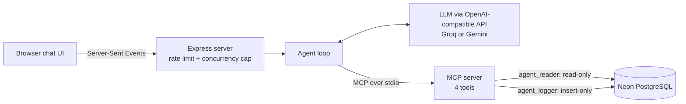

# SQL Agent — AI Analytics Assistant

Ask questions about a real e-commerce database in plain English. An AI agent explores the schema, writes SQL, runs it safely through layered guardrails, and explains the answer, streaming every step live.

**Live demo:** https://sql-agent-icsq.onrender.com
*(Free hosting: the first visit after a period of inactivity can take 30–60 seconds to wake up.)*

---

## What it does

> **You:** Which 5 product categories have the highest revenue?
>
> **Agent:** reads metric definitions → inspects `order_items`, `products`, `category_translation` → writes and runs a 4-table join → answers with a table, an auto-generated bar chart, and the exact SQL it used.

The dataset is the **Olist Brazilian E-Commerce** dataset: about 100,000 real marketplace orders (2016–2018) across 8 related tables, roughly 550,000 rows in total.

## Architecture



1. The browser sends a question; the server streams each agent step back over **Server-Sent Events**.
2. The **agent loop** sends the conversation and the available tools to the LLM, executes any tool calls through **MCP**, and repeats until the model gives a final answer (max 10 steps).
3. The **MCP server** exposes 4 tools and is the only component that touches the database.

### MCP tools

| Tool | Purpose |
|---|---|
| `list_tables` | List available tables |
| `describe_table` | Columns, types, primary and foreign keys, approximate row count |
| `get_metric_definitions` | Official business metric formulas and data rules (the semantic layer) |
| `run_query` | Run a single read-only `SELECT` through the guardrails |

## Security: defense in depth

No single check is trusted alone. Every query the AI writes must pass **four independent layers**:

1. **AST-based SQL validation:** the SQL is parsed into a syntax tree; only a single `SELECT` statement passes. `DELETE`, `DROP`, and multi-statement attacks like `SELECT 1; DROP TABLE orders` are rejected. Unparseable SQL is rejected too (*fail closed*).
2. **Read-only transaction:** queries run inside `BEGIN READ ONLY`, so writes hidden inside a SELECT (e.g. `nextval()`, `SELECT ... INTO`) are refused by Postgres itself.
3. **Least-privilege database roles:**
   - `agent_reader` can only `SELECT`, with read-only and timeout defaults enforced at the role level.
   - `agent_logger` can only `INSERT` into the audit log, which lives in a separate `ops` schema the agent cannot see.
   - The owner account is used only by the local data loader and is never deployed.
4. **Resource limits:** a 5-second statement timeout and a 100-row result cap (fetching 101 rows detects truncation).

Every tool call is recorded in `ops.audit_log` with its SQL, status (`ok` / `blocked` / `error`), row count, and duration.

## Semantic layer

LLMs guess what business terms mean. `src/metrics.ts` defines them once, and the agent is instructed to use these exact formulas:

- **revenue** = `SUM(price + freight_value)` for delivered orders only
- **late_delivery_rate**, **delivery_time_days**, **average_order_value**, **average_review_score**, and more
- **Data rules**, e.g. `customer_id` is unique *per order* in Olist, so real customers are counted with `customer_unique_id`. Without this rule, an agent reports **99,441** customers instead of the correct **96,096**.

## Reliability and cost control

- **Retries with exponential backoff** for temporary failures (429 rate limits, 5xx errors, network errors), respecting the provider's `retry-after` header. Permanent errors (400, 401) fail fast.
- **Per-IP rate limit** of 10 questions per hour, plus a **concurrency cap** of 2 simultaneous questions, because the real bottleneck is the LLM provider's shared tokens-per-minute quota.
- **Provider-agnostic LLM client:** any OpenAI-compatible API works; switching between Groq and Gemini is a configuration change, not a code change.

## Tech stack

TypeScript · Node.js · Model Context Protocol (MCP) SDK · PostgreSQL (Neon) · Express · Server-Sent Events · node-sql-parser · Groq / Gemini · Render

## Project structure

```
src/
  server.ts       MCP server: the 4 tools
  guard.ts        AST-based SQL validation
  db.ts           Read-only connection pool (agent_reader)
  audit.ts        Audit logging (agent_logger)
  metrics.ts      Semantic layer: metric definitions and data rules
  agentCore.ts    Agent loop: MCP client, LLM calls, retries, events
  agent.ts        Terminal interface
  web.ts          Express server: SSE streaming, rate limiting
public/
  index.html      Chat UI with live steps, auto charts, copy buttons
scripts/
  schema.sql      Table definitions
  roles.sql       Database roles and audit log
  load.ts         Bulk CSV loader using Postgres COPY
benchmark/
  questions.json  Test questions with reference SQL
  run.ts          Execution-accuracy benchmark runner
```

## Run it locally

**Requirements:** Node.js 22+, a PostgreSQL database (a free [Neon](https://neon.tech) project works), and an API key for an OpenAI-compatible LLM provider (e.g. [Groq](https://console.groq.com)).

```bash
git clone https://github.com/Gaurav075/sql-agent.git
cd sql-agent
npm install
cp .env.example .env    # then fill in your values
```

**Set up the database:**

1. Run `scripts/schema.sql` in your database, as the owner.
2. Run `scripts/roles.sql`, replacing each `CHANGE_ME` with a strong password.
3. Download the [Olist dataset](https://www.kaggle.com/datasets/olistbr/brazilian-ecommerce) and extract the CSVs into `data/`.
4. Load the data, then refresh table statistics:

```bash
npx tsx --env-file=.env scripts/load.ts
```
```sql
ANALYZE;
```

**Run:**

```bash
npm run dev                                                    # web UI at http://localhost:3000
npx tsx --env-file=.env src/agent.ts "How many orders were canceled?"   # terminal
npx @modelcontextprotocol/inspector npx tsx --env-file=.env src/server.ts   # inspect the MCP tools
```

## Design decisions and trade-offs

- **Comparing results, not SQL text, in the benchmark:** the same answer can be written as many valid queries, so the benchmark checks the agent's query *results* against reference queries (execution accuracy).
- **Fail-closed SQL validation:** the parser occasionally rejects valid Postgres syntax. That is preferred over allowing SQL it doesn't understand; the error goes back to the agent, which rewrites the query.
- **Errors as stream events:** the browser's `EventSource` cannot read error response bodies, so rate-limit and validation errors are sent as SSE events with a normal response.
- **Render instead of serverless:** the agent keeps the MCP server running as a long-lived child process, which serverless platforms cannot hold.
- **No multi-turn memory (yet):** each follow-up would resend the conversation, which is costly under free-tier token limits. Single-question accuracy was prioritized.

## Limitations

- Rate limits and the in-memory concurrency counter are per server instance; a multi-instance deployment would store them in Redis.
- IP-based rate limiting treats users behind one network as a single visitor.
- The benchmark grades the agent's final query result, not the wording of its explanation.

## Dataset and license

Data: [Brazilian E-Commerce Public Dataset by Olist](https://www.kaggle.com/datasets/olistbr/brazilian-ecommerce) (CC BY-NC-SA 4.0). The dataset is not included in this repository.

---

Built by **Gaurav Gupta** · [LinkedIn](https://www.linkedin.com/in/gauravgupta7431/) · [GitHub](https://github.com/Gaurav075)
